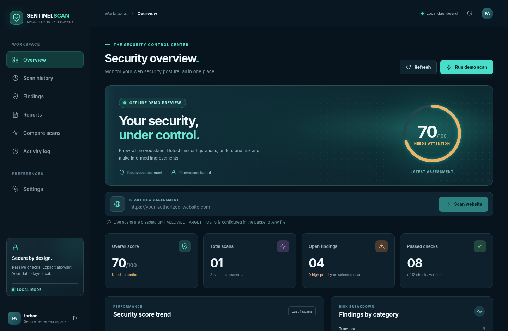

# SentinelScan 2.0 — Complete Local Security Workspace

**A private, responsive Python + React cybersecurity portfolio application by Farhan Ali.**

Built with **Python, FastAPI, React, TypeScript, SQLite and ReportLab**. This repository includes real, editable source code, prebuilt frontend assets, backend API, automated regression tests, and Windows launch scripts — not just a screenshot or UI mockup.



## What works

- **First-run owner registration**, secure password hashing using salted scrypt, login, logout and revocable eight-hour sessions. No hardcoded shared password or cloud credentials.
- **Owner-only API**, including saved scan history, findings, audit history, PDF reports and CSV exports. Login failures trigger a temporary lockout after repeated incorrect attempts.
- **Password updates and local recovery**; changing or resetting a password invalidates all sessions.
- **Offline demonstration scans** for an immediate portfolio presentation; their results are clearly marked as DEMO.
- **Authorized live website scans** for specified `ALLOWED_TARGET_HOSTS`, with defensive URL, DNS, TLS and redirect checks. Scans only public operator-approved sites — no aggressive vulnerability exploitation.
- **Responsive premium dark dashboard** with trend visualization, severity distribution, full findings explanations, scan comparison, report downloads and history deletion.
- **Local SQLite persistence** (scan history, account details, hashed session tokens and audit trail). No paid API, MongoDB or external account needed.

## Quick start on Windows 10 or 11

**Requirements:** Python **3.10+**, the Python Launcher `py -3`, and an internet connection *for first-time Python dependency installation*. React static assets are included; Node.js/npm is **not required to run the site**.

1. Extract the project ZIP. Open its `SentinelScan` folder.
2. Double-click **`start-all.bat`**. Keep the two console windows open. Allow the first-time backend dependency installation to finish.
3. Open **http://localhost:5173** in your browser. The API runs locally at **http://127.0.0.1:8000**.
4. On the first visit, create your **own owner username and strong password** (12 characters minimum). No default credentials exist.
5. After signing in, SentinelScan automatically creates a clearly labeled **offline demo scan** on an empty database. Run more demos, examine findings, compare scans, download PDF/CSV, inspect activity, or delete a scan.

If PowerShell execution restrictions block the launcher, open two PowerShell consoles inside the project root:

```powershell
powershell -ExecutionPolicy Bypass -File .\start-backend.ps1
powershell -ExecutionPolicy Bypass -File .\start-frontend.ps1
```

The private FastAPI documentation is available at http://127.0.0.1:8000/docs (sign in to obtain a bearer token when trying protected routes).

## Live scans: permission required

**Disabled by default.** Only enable for publicly reachable sites **you control or are authorized to assess**:

1. Make a copy of `.env.example` named `.env` in the project root.
2. Set `ALLOWED_TARGET_HOSTS=yourwebsite.com,www.yourwebsite.com` (exact hostnames, no protocols, wildcards or paths).
3. Restart the backend and sign in. Paste an `https://` URL from your allowlist, then select **Scan website**.

The scanner rejects disallowed hostnames, private/internal/link-local or metadata IPs, custom ports, unsafe redirects, URL userinfo and non-HTTP(S) URLs. DNS is resolved immediately before the request, and connections pin the validated IP (with original TLS server name/certificate checks). There is no crawling, fuzzing, attack payloads or login guessing. All results are saved to your private SQLite database.

> A high SentinelScan score only reflects the assessed headers/TLS indicators. It **does not certify that a website is secure**, nor replace a penetration test.

## Useful controls

| Page | Action |
|---|---|
| Overview | Run demo, launch authorized live scan, view score and findings charts |
| Scan history | View details or permanently delete a saved scan |
| Findings | Search, inspect evidence, read remediation guidance, download PDF |
| Reports | Download authenticated PDF reports and CSV history export |
| Compare scans | Compare baseline and latest stored scores |
| Activity log | See significant account and scan actions |
| Settings | Change API origin or change owner password (all sessions are revoked) |
| Owner menu | Sign out of the private workspace |

## Reset a forgotten password — local owner only

Only someone with **direct file access** to the local SQLite database can perform this recovery. Stop the backend, open PowerShell in the project folder, and run:

```powershell
$env:PYTHONPATH='backend'
.\.venv\Scripts\python.exe -m app.admin_cli
```

The command interactively asks for confirmation and a new password; it doesn't store or print the password. After a reset, restart the backend, refresh your browser and sign in again. **Back up your SQLite database** before deleting or reinstalling the project.

## Test it

```powershell
py -3 -m pip install -r backend\requirements-dev.txt
$env:PYTHONPATH='backend'
py -3 -m pytest -q backend\tests
py -3 frontend\smoke_test.py
```

Bash/Linux equivalent: `PYTHONPATH=backend python -m pytest -q backend/tests` and `bash frontend/build.sh` (requires globally available `tsc` to recompile TypeScript). The ready-to-run frontend dist is already bundled. For editable UI: modify `frontend/src/app.tsx` and `frontend/src/styles.css`, then run `frontend/build.sh` or `npm run build` if you have the TypeScript compiler. Automated CI is in `.github/workflows/ci.yml`.

## Project layout

```text
SentinelScan/
├── backend/
│   ├── app/
│   │   ├── main.py        # authenticated API and scan routes
│   │   ├── auth.py        # owner account, scrypt and revocable sessions
│   │   ├── admin_cli.py   # local recovery CLI
│   │   ├── policy.py      # allowlist + network restrictions
│   │   ├── scanner.py     # bounded passive checks
│   │   ├── storage.py     # SQLite scan persistence
│   │   ├── exports.py     # safe CSV download
│   │   ├── report.py      # PDF generation
│   │   └── demo.py        # offline seeded example
│   ├── tests/             # behavior and security regression tests
│   └── requirements.txt
├── frontend/
│   ├── src/app.tsx        # React dashboard, login and actions
│   ├── src/styles.css     # responsive layout and auth styles
│   └── dist/              # prebuilt, runnable frontend (vendor included)
├── docs/screenshots/     # verified desktop + mobile v2 preview screenshots
├── .github/workflows/    # CI checks
├── .env.example
├── start-all.bat
├── start-backend.ps1
└── start-frontend.ps1
```

## API endpoints

| Method | Route | Access |
|---|---|---|
| GET | `/api/health` | Public health and live-mode status |
| GET | `/api/auth/status` | Public: owner configured? |
| POST | `/api/auth/setup` | Local-only, once: create first owner |
| POST | `/api/auth/login` | Public: sign in |
| GET | `/api/auth/me` | Owner |
| POST | `/api/auth/logout` | Owner |
| POST | `/api/auth/password` | Owner: change password, revoke sessions |
| POST | `/api/scans/demo` | Owner: create offline example |
| POST | `/api/scans` | Owner: scan allowlisted target |
| GET | `/api/scans` | Owner: scan history |
| GET | `/api/scans/{id}` | Owner: detailed findings |
| DELETE | `/api/scans/{id}` | Owner: permanently delete |
| GET | `/api/scans/{id}/report.pdf` | Owner: private report |
| GET | `/api/reports/scans.csv` | Owner: escaped spreadsheet export |
| GET | `/api/audit` | Owner: activity log |

Protected requests use `Authorization: Bearer <your-session-token>`. The frontend keeps this token only in browser **sessionStorage**. The backend stores only a hash of each session token. The cookie-less bearer approach avoids implicit browser session CSRF, but as with any SPA, browser XSS remains important to prevent.

## Security / deployment notes — read before public hosting

This is a **complete local single-owner portfolio website**, **not** a hardened multi-tenant public SaaS or a live hosted site. It runs on localhost by default and is ready for learning, GitHub, demonstrations, and controlled authorized scanning. Public hosting requires additional work including HTTPS, hardened reverse-proxy/security headers, proper host/origin policy, deployment configuration, worker/background job limits, maintained frontend dependencies and an independent security review. The bundled React 16 runtime is legacy and should be upgraded before public deployment; the UI is distributed offline-compatible because this build environment cannot fetch npm registry dependencies.

**Do not forward port 8000 to the internet or remove the allowlist.** First-account setup is restricted to local clients, but do not expose an uninitialized instance through a proxy that presents remote traffic as localhost. Keep `.env` and `backend/*.db` private (both are excluded from git). Always choose a unique password, and only scan sites you have permission to assess.

**Professional headline:** Farhan Ali — Freelance MERN Stack Developer | Cloud Engineer | Cybersecurity Specialist.
